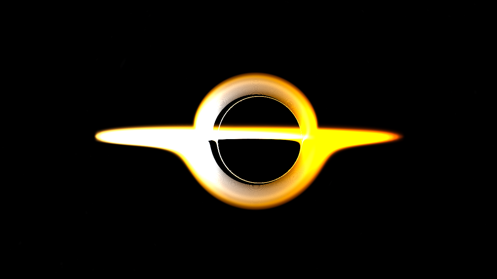

# Gargantua

A black hole, rendered on your CPU, one light ray at a time.

No GPU. No game engine. No shaders. One C++ file of plain arithmetic, and about eighty seconds a frame.



---

## What this actually is

Light doesn't travel in a straight line near a black hole. Space itself is bent, so light bends with it.

That makes the picture easy to compute, as long as you do it backwards. For every pixel on the screen, shoot a ray *outward* from the camera and follow it as it curves. Where the ray ends up — swallowed by the hole, or escaping into the stars behind it — that's the color of that pixel. Do it for every pixel and you have an image.

That's the whole idea. Everything else is bookkeeping.

This is a **Kerr** black hole: a *spinning* one, like the one in *Interstellar*. Spinning matters, because the hole drags space around with it as it turns, and that changes exactly where the light goes. (The black hole in the film is named Gargantua, which is where this repo gets its name.)

### First, the checkerboard


Same physics, drawn on a plain grid. Every line in the source is dead straight and evenly spaced — nothing is curved to begin with. All the bending you see is light taking a curved path through curved space. This is the version to stare at when you want to *understand* what's happening.

### Then the real thing


The bright band is the **accretion disk** — gas orbiting so fast that friction heats it until it glows. A few honest notes about what's physics and what's paint:

- The **shape**, the black **shadow**, and the way the disk's far side is lifted up and over the top — that's real. Nobody told the code to do that. It falls out of the ray-tracing on its own.
- The **color** comes from temperature. Hot things glow, and the color of that glow is fixed by physics — the same reason a heated iron bar goes red, then orange, then white. So the inner edge of the disk is white-hot and the outer edge is cooler and orange. That part is honest.
- One side of the disk is far **brighter and bluer** than the other. That's the **Doppler effect**. The gas on the side spinning toward you is approaching, so its light arrives bunched together — bluer and brighter. The side spinning away gets stretched — redder and dimmer. We exaggerate this beyond what reality would give, on purpose, to get the film's look. It's marked in the code as "the Interstellar cheat."
- The starfield is a real photograph, dimmed to about 5% — otherwise the hole's own glare drowns it out.

## Run it

You need a C++ compiler (`g++` or `clang++`). That's the only real requirement. `ffmpeg` is needed only if you want the video. Everything else is already in this folder — `kerr.cpp`, `stb_image.h`, and `space_background.jpg`. No package manager, no build system, no install step.

```bash
# compile
g++ -std=c++17 -O3 -march=native -fopenmp kerr.cpp -o kerr

# one still image   ->  kerr_hamiltonian.ppm
./kerr

# a 300-frame fly-around   ->  frames/f_0000.ppm, f_0001.ppm, ...
./kerr orbit 300
```

That's the entire interface. The `-fopenmp` flag spreads the work across your CPU cores. The rows of the image don't depend on each other, so the result is byte-for-byte identical to a single-threaded run — just roughly ten times faster.

### Running it from Claude Code

If you have this repo open in Claude Code, you don't need to remember any of that. Just type:

```
/render
```

It asks whether you want a single image or a video, compiles the code if needed, renders, converts the result for you (PNG for a still, MP4 for the video), and tells you where the file is. One source file, one command, either output.

### Turning frames into a video

The frames come out as `.ppm` files — raw and uncompressed, because that format is trivial to write with no libraries. `ffmpeg` turns them into an MP4:

```bash
ffmpeg -framerate 30 -i frames/f_%04d.ppm \
       -vf "hflip,vflip" \
       -c:v libx264 -crf 18 -pix_fmt yuv420p -movflags +faststart \
       -y gargantua_orbit.mp4
```

The `hflip,vflip` pair is a 180° rotation — the camera rig renders upside-down without it.

## How long it takes

| what | time |
|---|---|
| one still, 1280×720 | ~80 seconds |
| one orbit frame | ~20 seconds |
| a 300-frame video | ~1.5 hours |

The cost is arithmetic. Every ray takes up to 500 integration steps, and each step inverts a 4×4 matrix a few times to find how space is curved right there. That inner loop is what wants a GPU.

## What's next

These are the things this code is *asking* to become:

- **A real GPU kernel.** The inner loop is embarrassingly parallel and embarrassingly numeric — the textbook case for CUDA or OpenCL. A port should give a hundred- to a thousand-fold speedup, turning a 90-minute video into a coffee break. This is the big one.
- **A live WASD mode.** Fly the camera around the hole in real time — move with W/A/S/D, look with the mouse, watch the disk spin. On a CPU this is a slideshow; it needs a steady framerate to feel like anything. So it waits for the GPU kernel first.
- **More honest physics.** The disk is optically thin and hand-tuned. A real radiative-transfer treatment — actual opacity, scattering, turbulence where it belongs — would make it true instead of merely pretty.
- **A real Schwarzschild mode.** The static (non-spinning) case, done cleanly, would be a good teaching counterpart to the Kerr code. See the file notes below for why it doesn't exist yet.

## The files

| file | what it is |
|---|---|
| `kerr.cpp` | **The renderer.** Spinning (Kerr) black hole, glowing disk, orbit mode. This is the one that matters. |
| `stb_image.h` | A single-header image loader (public domain). Lets us read the sky JPEG without pulling in a dependency. |
| `space_background.jpg` | The starfield used as the sky. |
| `gargantua.png` | The checkerboard-lensing still. The "understand it" picture. |
| `gargantua_kerr.png` | The starfield-and-disk still. The "feel it" picture. |
| `gargantua_orbit.mp4` | A ten-second fly-around, rendered by the orbit mode above. |
| `schwarzschild.cpp` | Misnamed, and worth saying so: this is a Shadertoy checkerboard port, kept only to produce the checkerboard image. It is *not* a Schwarzschild ray-tracer, despite the name. |

---

Built because black holes are the best thing in the universe, and they ought to be runnable on a laptop.
